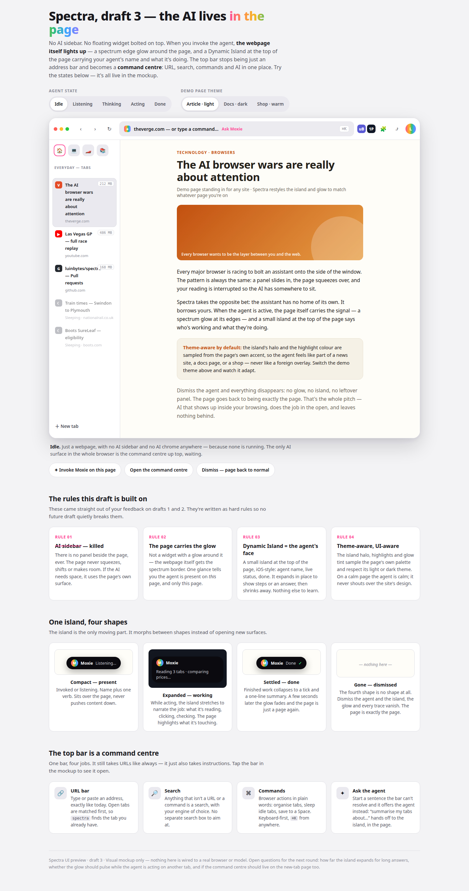
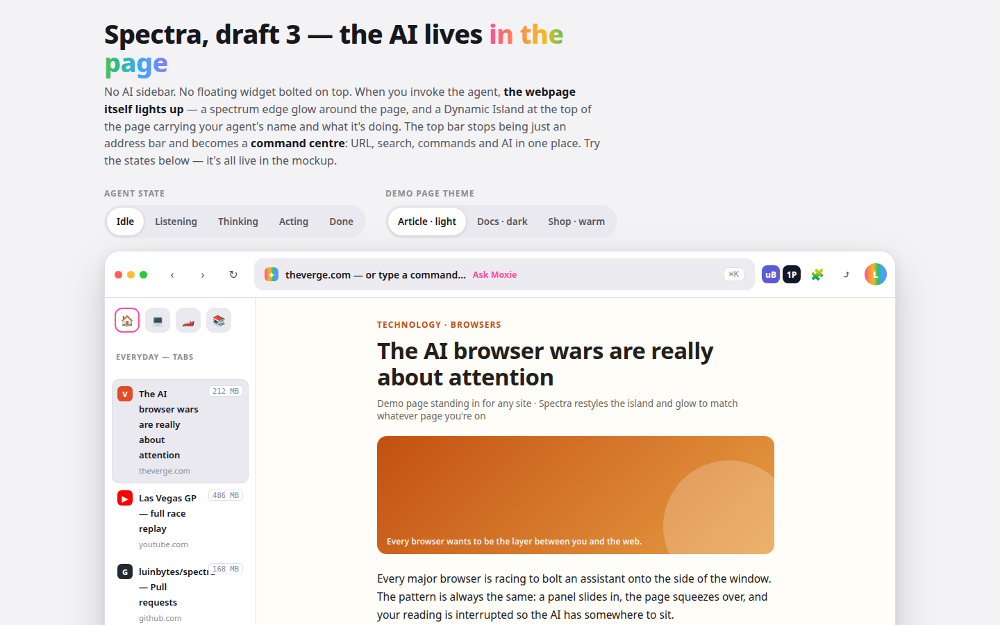
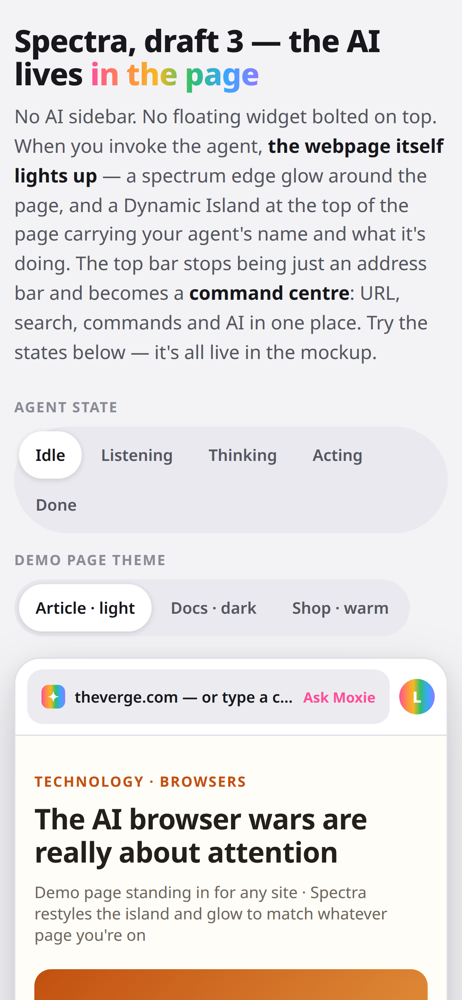
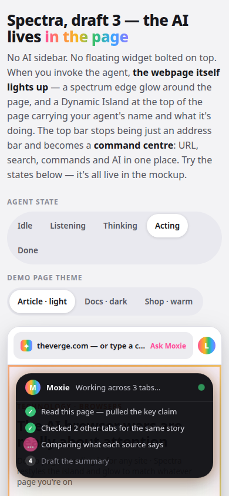
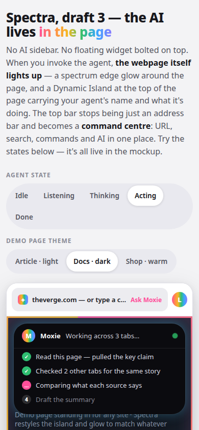
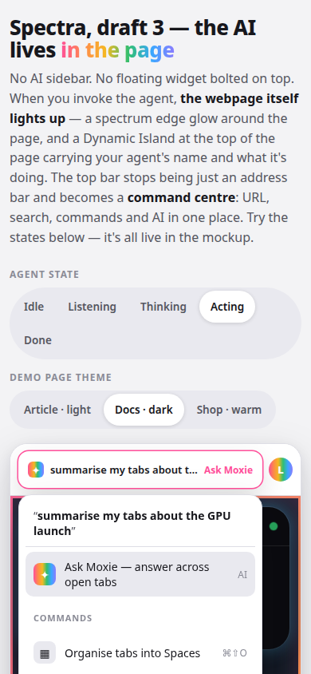

# Spectra UI direction

Status: locked by Lu on 2026-11-23 as a **proof of concept**.

Read this first if you are building from it, human or agent: the preview
linked below is a rough draft. Locked means the principles in this document,
not the draft's pixels. Do not remake the draft one to one. Its exact layout,
spacing, typography, colours beyond the spectrum identity, and all
placeholder copy are disposable. The principles are the requirements.

The interactive draft is the "Spectra UI Preview" page (draft 3, built
2026-11-23). The screenshots in `docs/images/` are captures of that draft.

## The principles

1. **No AI sidebar, ever.** There is no panel beside the page. The page never
   squeezes, shifts, or makes room. If the AI needs a surface, it uses the
   page's own surface.
2. **The page carries the glow.** When the agent is invoked, talking, or
   working on a page, the webpage itself gets a spectrum glow border around
   its whole edge. One glance says the agent is present on this page, and
   only this page.
3. **A dynamic island is the agent's face.** An iOS style dynamic island sits
   at the top of the page carrying the agent's name and what it is doing
   right now. It morphs between shapes instead of opening new surfaces:
   compact while present or listening, expanded while working (narrating its
   steps in place), settled with a tick and a one line summary when done, and
   gone entirely when dismissed, leaving the page exactly the page.
4. **Theme aware, UI aware.** The island's halo, the highlight colour, and
   the glow tint are sampled from the page's own accent and respect its light
   or dark theme, so the agent feels like part of the site it is on, never a
   foreign overlay stamped over it.
5. **The top bar is a command centre.** One bar, four jobs: it takes URLs
   like always, anything that is not a URL or a command is a search, browser
   commands run in plain words (organise tabs, sleep idle tabs, save to a
   Space), and a sentence it cannot resolve is offered to the agent instead.
   Keyboard first.
6. **The rail is the browser's home.** Spaces with their own spectrum colour
   identity, pinned sites as apps, vertical tabs with memory use visible per
   tab, sleeping tabs named as sleeping, and extensions with a proper visible
   home, not buried in a menu.
7. **Nothing silent.** Nothing closes, archives, renames, or tidies away
   without the user seeing it happen or asking for it.

## How the AI stack shows up in this UI

The four AI layers (see, think, organise, act) all surface through the island
and the command centre, nowhere else:

- Asking goes through the command centre, answers land in the island,
  expanded in place, with their sources.
- Organising is suggested, never applied silently; the island narrates it and
  the user applies or dismisses.
- Acting is visible step by step in the expanded island, and anything that
  sends, buys, or deletes stops for approval first.
- The model is picked per Space, not locked to one vendor.

## Screenshots from the draft

Full draft page, idle on a light article page. No agent running, so no glow
and no island; the only AI surface is the command centre waiting up top:

Desktop width, top of the draft:

The same draft at phone width:

Agent acting on a light article page: the page edge glows and the island is
expanded, narrating its steps:

Agent acting on a dark docs page: the island and glow restyle themselves to
the page's dark theme and accent:

The command centre open, with a question routed to Ask and the command list
under it:

## Open questions from the draft

- How far should the island expand for long answers before it becomes the
  sidebar it replaced?
- Should the glow pulse while the agent is acting on a different tab?
- Should the command centre live on the new tab page too?
